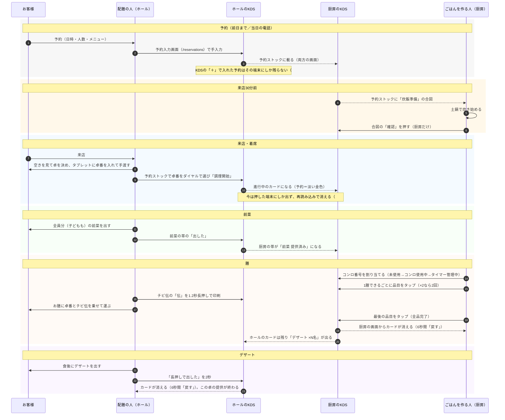
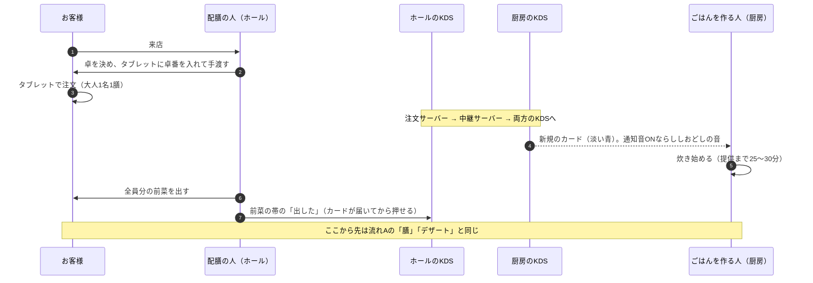

# 業務フロー：ごはんを作る人と配膳の人（2026-10-21）

1卓のお客様が来て帰るまでを、**ごはんを作る人（厨房）**と**配膳の人（ホール）**がそれぞれ「いつ・何を見て・何を押すか」で追う。デシャップ（KDS）の今の実装に合わせて書き、実装と運用が合っていない所・まだ店に確かめていない所は「要確認」として最後にまとめる。

[業務フロー.drawio](業務フロー.drawio)（2026-06-04）は予約から注文までの骨組みで、役割は厨房1列だけだった。その後に決まった前菜・デザートの帯、炊飯の合図、チビ伝をホールで刷る運用、TableCheck連携の中止を反映して、役割ごとに書き直したのが本書。

## 前提

| 項目 | 内容 | 根拠 |
| :--- | :--- | :--- |
| KDS の台数と置き場所 | 2台。**厨房（コンロ側）に1台**、**ホール／中間スタッフが触れる位置に1台** | [2026-06-03 運用確認](../knowledge/2026-06-03_運用確認_電源充電・KDS台数.md) C |
| 画面のモード | 厨房の KDS は「キッチン」、ホールの KDS は「ホール」で使う | [デシャップ画面仕様](deshup-spec.md)「モード/権限」 |
| 調理の主権 | 品目の完了・コンロ・カードの並べ替えは**厨房だけ**が押す。ホールは見るだけ | [2026-07-16 議事録](../knowledge/2026-07-16_議事録_使用感デモ・UI方針.md) §5 |
| 提供の主権 | 前菜・デザートの「出した」と、チビ伝の印刷は**ホールだけ**が押す。厨房は見るだけ | [提供ルール](../knowledge/2026-09-03_提供ルール_一人一膳と提供順.md) §4、[チビ伝の運用](../knowledge/2026-09-03_チビ伝の運用_ホール側で出す.md) |
| 提供順 | **前菜 → 注文された膳 → デザート**。前菜は子どもを含む全員分、膳は大人1名1膳 | [提供ルール](../knowledge/2026-09-03_提供ルール_一人一膳と提供順.md) §1・§2 |
| 炊飯にかかる時間 | 土鍋の膳は提供まで25〜30分。予約客は来店の約30分前から炊き始める（もともとの店の運用） | [2026-06-04 議事録](../knowledge/2026-06-04_議事録.md)、[予約席・座席DB設計判断](../knowledge/2026-06-03_予約席・座席DB設計判断.md) E |
| 客席タブレット | フリーアドレス。卓番は配膳の人が手渡すときに入れる | [予約席・座席DB設計判断](../knowledge/2026-06-03_予約席・座席DB設計判断.md) A |
| 予約の入力 | 店員の手入力（TableCheck連携は2026-10-11に中止）。予約対応はほぼホール／中間スタッフで、厨房はほとんどしない | [README](../README.md)「予約ストック」、[2026-06-03 運用確認](../knowledge/2026-06-03_運用確認_電源充電・KDS台数.md) C |

## 役割

| | ごはんを作る人（厨房） | 配膳の人（ホール／中間） |
| :--- | :--- | :--- |
| 見る画面 | 厨房の KDS（キッチン） | ホールの KDS（ホール） |
| 主な仕事 | 土鍋で炊く、膳を仕上げる | 予約を受ける、席に案内する、前菜・膳・デザートを運ぶ |
| KDS で押すもの | 炊飯の合図の「確認」、コンロ番号、品目（1膳できるごとに1回。ドリンクも品目に並ぶ）、カードの並べ替え | 予約の追加、予約の「調理開始」（卓番をダイヤルで選ぶ）、前菜の「出した」、チビ伝の「伝」、デザートの「長押しで出した」 |
| KDS で押さないもの | 前菜・デザート、チビ伝 | 品目、コンロ、並べ替え |

## 流れA：メニューまで予約したお客様

## 流れB：予約なし（新規）・席だけ予約のお客様

席だけの予約は予約ストックに載らない（何を炊くか分からないため）。来店してからは新規のお客様と同じ流れになる。

## 段階ごとの一覧

| 段階 | お客様 | 配膳の人（ホール） | ごはんを作る人（厨房） | KDS の表示 |
| :--- | :--- | :--- | :--- | :--- |
| 予約 | 日時・人数・メニューを伝える | 予約入力画面（`/reservations`。試作）で手入力する。KDS の「＋」は日付が入れられず、入れた端末にしか残らない（中継サーバーへ保存しない作り。#292） | — | 予約ストックに時間順で並ぶ |
| 来店30分前 | — | — | 炊き始め、合図の「確認」を押す | ご飯ものを含む予約に「炊飯準備」の合図。確認は厨房だけ |
| 来店・着席 | 来店 | 卓を決め、タブレットに卓番を入れて渡す。予約は「調理開始」で進行中へ移す | — | 進行中のカード（予約＝淡い金色、新規＝淡い青） |
| 注文（新規） | タブレットで注文 | — | 注文を見て炊き始める | 新規のカードが届き、通知音（ししおどし） |
| 前菜 | 前菜を受け取る | 全員分を出し「出した」を押す | 未提供の卓を見て把握する | ホール：帯が畳まれる。厨房：「前菜 提供済み」 |
| 膳 | 膳を受け取る | チビ伝を刷り、お膳に卓番と一緒に乗せて運ぶ | コンロを割り当て、1膳できるごとに品目をタップ | 経過時間が緑→琥珀（5分）→赤（10分超） |
| 全品完了 | — | ホールのカードに「デザート ×N名」が出る | 最後の品目（ドリンクを含む）をタップ。カードが消える | 厨房：カードが消える。ホール：デザート待ちのカードが残る |
| デザート | デザートを受け取る | 「長押しで出した」を2秒 | — | カードが消え、卓の提供が終わる |

## 要確認・既知の問題

| # | 内容 | 状態 |
| :--- | :--- | :--- |
| 1 | 前菜を出していない卓でも、デザートを出してカードを消せる。前菜を出さずにデザートへ進む運用が実際にあるか | [#289](https://github.com/itiwoja/pokapoka-system/issues/289)。店に確かめてから直す |
| 2 | 厨房とホールを別端末にすると、前菜・デザートの状態が伝わらず、ホールのリロードでデザート待ちのカードが消える | [#288](https://github.com/itiwoja/pokapoka-system/issues/288)。修正の PR #290 がレビュー待ち |
| 3 | 大量注文のときは蒸らしで土鍋をコンロから降ろすため、コンロ番号が実態と合わなくなる | [#161](https://github.com/itiwoja/pokapoka-system/issues/161)。店に聞いてから決める |
| 4 | 卓番の上書き（厨房だけの表示。#160）は別端末へ届かない。チビ伝はホールで刷るので、厨房で卓番を直しても、ホールのチビ伝は元の卓番で出る | [#293](https://github.com/itiwoja/pokapoka-system/issues/293)。ペルソナテストで再現した |
| 5 | チビ伝を刷るのは、注文が届いたときか、膳ができたときか | 店に未確認 |
| 6 | 新規のお客様は、注文が届くまでカードが無い。来店してすぐ前菜を出しても、「出した」を押せるのは注文が届いてから | 運用として困るかは店に未確認 |
| 7 | 予約客が来ない・遅れるとき、30分前に炊き始めた土鍋をどうするか。同じ時間帯に予約が集まったときの土鍋の数の上限 | [予約席・座席DB設計判断](../knowledge/2026-06-03_予約席・座席DB設計判断.md) E の残課題。実装は止めない |
| 8 | 予約を入れる入口（画面・API）の形。KDS の「＋」で入れた予約は入れた端末にしか残らず、厨房に炊飯準備が出ない | [#292](https://github.com/itiwoja/pokapoka-system/issues/292)。入口の設計の前に確認が要る |
| 9 | 予約の「調理開始」を押すのは誰で、いつか（ボタン名と旧フローの方式Cでは30分前に厨房、仕様書では来店時にホール）。今は押した端末にしかカードが出ず、再読み込みで消える | [#291](https://github.com/itiwoja/pokapoka-system/issues/291) |
| 10 | ドリンクも厨房の品目に並び、厨房が押さないとカードが終わらない（デザートの帯が出ない）。ドリンクを作る・運ぶのは誰か | 店に未確認。[#295](https://github.com/itiwoja/pokapoka-system/issues/295) |
| 11 | 品目のアレルギーが備考と同じ灰色の小さい字で、厨房で見落としやすい | [#294](https://github.com/itiwoja/pokapoka-system/issues/294) |
| 12 | 経過時間の色（5分で琥珀、10分で赤）が、土鍋の提供まで25〜30分と合わない | [#295](https://github.com/itiwoja/pokapoka-system/issues/295)。閾値は店と決める |

ペルソナ2体（ごはんを作る人・配膳の人）がこのフローどおりに通したテスト（2026-10-21）の、中・低の指摘は [#295](https://github.com/itiwoja/pokapoka-system/issues/295) にまとめた。
